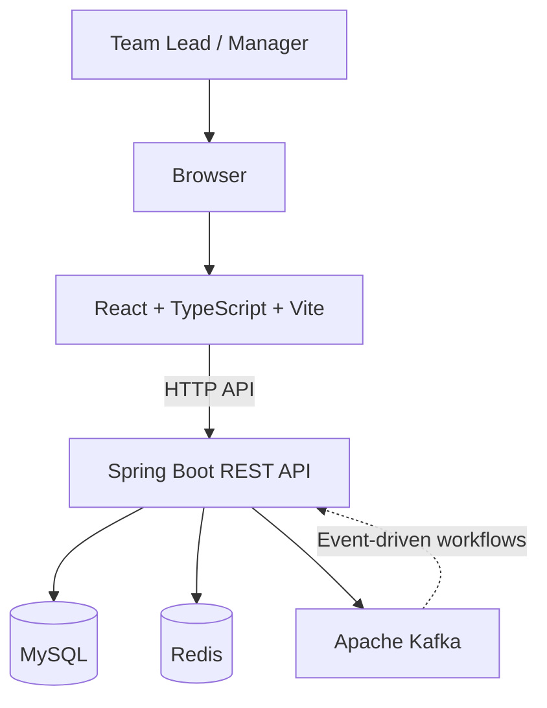

<div align="center">

# Incident
### AI-Powered Production Incident Response System

**Monitor services. Investigate incidents. Coordinate recovery.**

A full-stack incident-response platform that brings incident management and operational visibility into one workspace, with AI-assisted investigation workflows for engineering teams.

</div>

---

## Overview

**Incident** is a full-stack portfolio project built around the production incident-response lifecycle. It provides a manager-focused interface for working with incidents and viewing operational information about services, logs, metrics, and deployments. Its AI-assisted investigation workflow is designed to help an operator investigate a failure and evaluate possible next steps.

The application is built with a React and TypeScript frontend, a Java/Spring Boot backend, and supporting infrastructure services. Docker Compose brings the frontend, backend, MySQL, Redis, and Kafka together for local development and verification.

### Project status

The project has been built and verified locally:

- Backend Maven build succeeds.
- Frontend production build succeeds.
- Frontend and backend Docker images build successfully.
- Docker Compose starts the application services.
- The frontend is reachable at `http://localhost/`.
- The backend health endpoint is reachable at `http://localhost:8080/actuator/health`.
- MySQL, Kafka, and Redis reported healthy container status during local verification.

**Public production hosting is not claimed here.** Hosting, HTTPS, production secrets, persistent-storage policy, and operational monitoring must be configured for the target environment before treating a public deployment as production-ready.

## Product goals

Incident is designed to help a team lead:

- Work with incidents through a dedicated incident-management interface.
- Open an incident-specific investigation view.
- View service information and service details.
- Access logs and metrics views during investigation.
- Review deployments and deployment details.
- Use an AI-assisted investigation workflow as part of incident response.
- Access application settings through an authenticated, protected application experience.

The product is focused on one primary operator: the engineering team lead or manager.

## Features and application areas

| Area | Purpose |
|---|---|
| Authentication | Login and registration screens, with protected application routes |
| Overview | Central operational overview |
| Incidents | Browse and work with incidents |
| Incident investigation | Open a dedicated investigation view for an incident |
| Services | Browse services and view individual service details |
| Logs | Access the logs interface |
| Metrics | Access the metrics interface |
| Deployments | Browse deployments and view deployment details |
| Settings | Access application settings |
| AI-assisted investigation | Investigation workflow intended to support root-cause analysis and response decisions |

The application also includes backend infrastructure for relational persistence, caching/data services, and event messaging. Feature behavior is determined by the current implementation in the repository; this README does not claim that every incident is detected or remediated fully autonomously.

## Architecture



### Component responsibilities

- **Frontend:** React and TypeScript application served by Nginx in the containerized setup.
- **Backend:** Java and Spring Boot application exposing the API used by the frontend.
- **MySQL:** Relational database used by the backend.
- **Redis:** Supporting data service configured for the application.
- **Kafka:** Event-messaging infrastructure configured for the application.
- **Docker Compose:** Coordinates the local application services.

The diagram represents the main deployed components. Specific event flows and Redis use are defined by the current backend implementation and configuration.

## Technology stack

| Layer | Technology |
|---|---|
| Frontend framework | React |
| Language | TypeScript |
| Frontend build tool | Vite |
| Routing | React Router |
| UI and animation | Tailwind CSS, Framer Motion, Lucide |
| Backend language | Java |
| Backend framework | Spring Boot |
| Build tool | Maven Wrapper |
| ORM / persistence | Spring Data JPA and Hibernate |
| Database migrations | Flyway |
| Relational database | MySQL 8 |
| Supporting data service | Redis 7 |
| Event messaging | Apache Kafka 4 |
| Static web server | Nginx |
| Containers | Docker and Docker Compose |
| CI workflow | GitHub Actions |

## Repository layout

The repository contains the frontend application, Spring Boot backend, container configuration, Maven build files, and GitHub Actions workflow. The principal files and directories include:

```text
incident/
├── frontend/                 # React + TypeScript frontend
├── src/                      # Spring Boot backend source and resources
├── .github/
│   └── workflows/            # GitHub Actions workflow(s)
├── docker-compose.yml         # Multi-service local environment
├── Dockerfile                 # Backend container build
├── pom.xml                    # Maven project configuration
├── mvnw                       # Maven Wrapper for Unix-like systems
├── mvnw.cmd                   # Maven Wrapper for Windows
├── .env.example               # Environment template, when present
└── README.md
```

## Run locally with Docker Compose

### Prerequisites

- Git
- Docker Desktop with Docker Compose on Windows, or Docker Engine and the Compose plugin on Linux
- A terminal (PowerShell commands are shown for Windows)

### 1. Get the source code

Clone this repository from its GitHub page, then open a terminal in the repository root—the directory containing `docker-compose.yml`.

### 2. Configure environment variables

Review `docker-compose.yml`, the backend configuration, and `.env.example` to identify the environment variables required by the current version.

If `.env.example` is present, create a local environment file:

```powershell
Copy-Item .env.example .env
```

Set local values for all required variables, such as database connection details, authentication/JWT secrets, CORS allowed origins, and any provider configuration required by enabled integrations. Use the exact variable names expected by the repository configuration.

**Do not commit `.env` or real credentials.** The `.env.example` file should contain placeholder values only.

### 3. Build the images

Run this from the repository root:

```powershell
docker compose build
```

### 4. Start the services

```powershell
docker compose up -d
```

### 5. Check service status

```powershell
docker compose ps
```

Wait for services configured with health checks to report healthy. To inspect logs:

```powershell
docker compose logs --tail=100
```

For a single service:

```powershell
docker compose logs --tail=100 backend
docker compose logs --tail=100 frontend
docker compose logs --tail=100 mysql
docker compose logs --tail=100 redis
docker compose logs --tail=100 kafka
```

### 6. Open the application

| Component | Local address |
|---|---|
| Frontend | `http://localhost/` |
| Backend health | `http://localhost:8080/actuator/health` |
| MySQL host port | `localhost:3307` |
| Redis host port | `localhost:6379` |
| Kafka host port | `localhost:9092` |

The database, Redis, and Kafka host ports are for local development. Do not expose these services directly to the public internet for a hosted deployment.

### Stop the services

```powershell
docker compose down
```

This stops and removes the Compose containers and network. Do not use `docker compose down -v` unless you deliberately intend to remove Compose-managed volumes and understand the resulting data-loss risk.

## Build and verify locally

### Frontend

From the repository root:

```powershell
cd frontend
npm ci
npm run build
```

The production build is generated in `frontend/dist/`.

To return to the repository root:

```powershell
cd ..
```

### Backend

From the repository root, run the Maven Wrapper:

```powershell
.\mvnw.cmd clean verify
```

The backend build may require environment variables to be available to the PowerShell process. Configure required local variables before running it. Never paste real secrets into source files or commit them to Git.

## API and health checks

The backend health endpoint is:

```http
GET /actuator/health
```

Local URL:

```text
http://localhost:8080/actuator/health
```

For the rest of the API, consult the backend controllers, request/response DTOs, and security configuration in the source tree. Endpoint behavior and required request payloads are defined by the current implementation.

## Configuration and secrets

Configuration is environment-specific. Before running or deploying the project, review the Compose file, backend configuration, and environment template.

Configuration categories may include:

- MySQL JDBC URL, username, and password
- Authentication and JWT secret/settings
- CORS allowed origins
- Redis connection settings
- Kafka bootstrap servers
- AI provider/model configuration, if required by the enabled AI workflow
- Frontend API base URL, if configured separately

Use unique, strong credentials for every hosted environment. Do not reuse development credentials in production. If a secret is accidentally committed, removing it from the latest commit alone may not remove it from Git history; rotate the credential and follow GitHub's guidance for sensitive-data exposure.

## Security and production considerations

The local Compose environment is a development and verification setup, not by itself a complete public-production configuration.

Before a public deployment:

- Store secrets in the hosting platform's secret/environment-variable manager.
- Serve the application over HTTPS.
- Use a production database with persistent storage, access controls, backups, and a recovery plan.
- Keep MySQL, Redis, and Kafka private to the application network unless a specific secured access pattern requires otherwise.
- Review CORS allowed origins and authentication/authorization behavior.
- Review Actuator exposure and avoid publishing sensitive operational details.
- Configure centralized logs, health monitoring, restart behavior, and alerting.
- Verify database migrations and recovery procedures.
- Run smoke tests against the deployed environment.

## Testing and verification

The following checks have been completed in the local development environment:

- Backend Maven build completed successfully.
- Frontend production build completed successfully after route-level lazy loading.
- Docker images for the frontend and backend built successfully.
- Docker Compose services started.
- Frontend browser access was verified.
- Backend `/actuator/health` was verified.
- MySQL, Redis, and Kafka reported healthy container status during verification.

These checks establish local build and runtime status; they are not a claim of load testing, security certification, or public-production availability.

## Development workflow

A typical local development workflow is:

1. Make a focused code change.
2. Run the relevant frontend or backend build.
3. Start or update the local Compose services when needed.
4. Check container logs and health status if a service fails.
5. Review `git status` and ensure no local secret files are staged.
6. Commit and push the verified changes.

Useful commands:

```powershell
git status
docker compose ps
docker compose logs --tail=100
docker compose build
docker compose up -d
```

## Roadmap

Potential next steps for the project include:

- Publish the verified source and documentation to GitHub.
- Add screenshots captured from the current application.
- Keep the architecture diagram aligned with the actual event and data flows.
- Expand automated tests for core workflows and failure cases.
- Deploy to a public hosting environment with HTTPS, persistent storage, and managed secrets.
- Add production monitoring, backup verification, and operational runbooks.

The roadmap is forward-looking; it should not be read as a statement that these items are already complete.

## Screenshots

Screenshots are intentionally not embedded in this README because they should come from the current, real application. When adding them, store them in the repository (for example, under `docs/screenshots/`) and make sure they do not reveal passwords, tokens, personal data, or sensitive infrastructure details.

## License

No license is declared by this README. Unless a `LICENSE` file is added to the repository, others do not automatically receive permission to reuse, distribute, or modify this project. Add a license only when you have decided which terms should apply.
